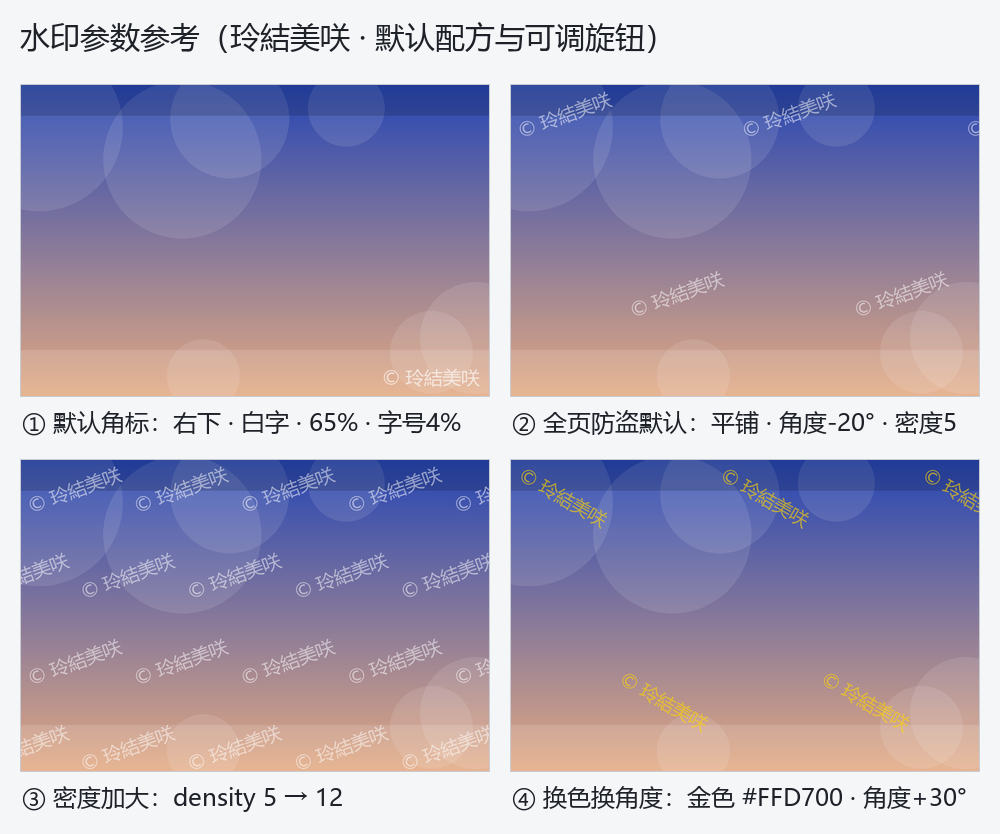

# 玲結美咲 · QQ 工具型 Agent（开源版）

私聊工具型 QQ agent：接入一个 QQ 号，定位是「会干活的 agent」而非纯聊天 bot。
基于 [AbyssalQuill/Kizuna](https://github.com/AbyssalQuill/Kizuna)（MIT）的 qq-bridge 平台层，经安全审计、大量新工具与治理规则扩展而来。已在云服务器 7×24 实跑。

## 能力一览（100+ 工具）

- **消息与人格**：拟人节奏（打字延迟/多气泡/已读不回）、表情包库、角色卡切换、三级记忆（chat.db 全量 + 会话窗口 + 结构化长期记忆）、友谊记忆（对方分享的大事当轮建档）
- **办公**：qq_send_docx / qq_send_pptx / qq_send_xlsx（大纲式生成，服务端硬上限）
- **图像**：qq_generate_image（CogView-4）、pixiv 搜索、表情包收藏，非 owner 每日配额 + 画前确认参数
- **资源**：YouTube 搜索/下载（代理可配、域名白名单、日限次/限体积/自动清理）、网页抓取、语音转写
- **媒体合成**：代码合成路线（subagent 写脚本 + ffmpeg 转 m4a/mp4，qq_send_file 交付）
- **任务外包**：subagent 工具——主会话零本地工具，沙箱子代理是唯一执行通道，产物走文件白名单送回
- **QQ 空间**：自主发动态（周计划调度：概率定次数/最小间隔/静默时段）+ 自动点赞巡航（名单制/日上限/tid 去重）
- **私聊工作站**（2026-10-27）：发素材 + 说需求 → 结果以文件交付。文件格式转换（能力表由服务器实测生成，装什么才承诺什么；Office 宏安全=3 + unshare 断网）、图片编辑（压缩/裁剪/形状遮罩/**旋转平铺水印**/多图 GIF/批量→ZIP）、PDF 合并·拆分·加水印（pypdf + reportlab）、二维码（qrencode/python-qrcode/segno 三引擎降级）、文本·JSON 工具（16 种纯字符操作）；只限私聊，owner 不限额、普通用户日配额
- **音色复刻交付**（2026-10-27）：千问 voice-enrollment + SpeechSynthesizer 全链——多段样本质检打分选最佳、按用户隔离的音色档案、**consent 闸门**（仅本人或明确授权，拒绝公众人物与冒充）与**AI 生成标记**（不可摘除），交付 mp3/wav/m4a/ogg/flac；标准网关与业务空间两种端点形态均支持
- **功能自解释**（2026-10-27）：每个功能一张教学卡（说明/额度/参数默认值/完整实例/调参指南）入 `capabilities-kb.js`，模型经 `qq_help` 先查卡再回答、不编参数；视觉类功能可现场生成**演示图**（与真实交付同一条管线，永不漂移）——"没有卡的功能=没做完的功能"
- **B 站 M3/M4**（2026-10-27）：全自动动态发布（周计划调度，`submit_check` 等级门前置，AIGC 声明 `aigc:2` 明牌）与视频投稿（file_meta → multipart 分片多 CDN → complete 取 cid → videocheck → `add/v3` wbi 签名提交，全程明牌 AI）；投币（余额-6 储备金硬闸）/关注/完播率点赞/视频卡推 QQ
- **B 站远程投稿 MCP**（2026-10-28）：`mcp-bili-remote.js`——大脑在本机、B 站凭据只在服务器时，用 SSH stdio 把服务器上的 bili-cli 代理成本地 MCP（不开监听端口、本机零 B 站凭据）；上游工具白名单（评论/私信/动态/关注不暴露），投稿参数结构化传入、argv 桥侧拼装，**默认仅自己可见**，公开需显式配置 `social.biliUpload.allowPublic`；投稿封面由 ffmpeg 脚本现生成（`deploy/media-gen/make-cover.sh`）
- **陪伴与节奏**（2026-10-29）：回复气泡数由桥掷骰（70/25/5、单句上限 3，模型写整句不预拆）；陪伴模式**括号反馈**——`misaki@reaction` 总开关（默认关），普通档每气泡 (10+x)%、实时档（对方做出动作后 5 分钟内）100%，动作类 6 气泡去重、8% 动作链（2 条 67% / 3 条 33%）与 8% 单个纯动作，常规模式一律不出括号；白名单私聊**每日早安**（7-8 点 33% / 8-9 点 67% 确定性骰子，不占主动配额，对方已先开口则当日跳过）；拍一拍回拍策略、好友记忆覆盖、表情包事件治理
- **kizuna 仪表盘**（手机 PWA）：三单元健康灯（失效=灰）、好友审批、白名单、按会话静默、**好友额度卡**（逐会话今日进度条 + 剩余 + ¥估算 + 14 天柱状图）

## 治理与安全

- **token 预算双轨**：owner 不限额，非 owner 每会话每日上限；超限走「预算申请协议」——她替用户私聊 owner 申请，owner 一句话授权，服务端强制 owner-only（伪造 token 实测 403）
- **模型档位 owner 专权**：非 owner 不能切模型/思考强度
- **风险对话告警**：反复打探密钥/社工冒权/违法请求/辱骂 → 她私聊 owner 检举（首次玩笑包容）
- **TASK_ACK**：长任务先表态（收到+做什么+ETA）再开工
- **不合理需求三线**：诚实边界（长数据直接写必是编造→转真计算）/ 成本边界（超阈值先报价）/ 恶意不判定（走检举线）
- **凭据纪律**：密钥只在 config/state（gitignored），控制台 fail-closed，agent-token 与 console-token 双通道分权

## 部署

见 `deploy/安装与接入.md`（服务器实测过的逐步手册）：NapCat Shell + qq-bridge + DSH 三个 systemd 单元；二维码扫码登录；`qq-bridge/config.example.json` 逐键注释（含大量实测依据）。

```bash
cd qq-bridge && npm install
cp config.example.json config.json   # 填 ownerQQ / napcat 端口 / DeepSeek key
node src/bridge.js
```

模型：DeepSeek V4.1 Flash（`deepseek-official` 路由，DSH 0.1.2-rc.1）；兼容 vision 模型挂图。

## 测试

- `node --test qq-bridge/tests/`（75 个测试文件、400+ 项断言：概率骰子纯函数、括号反馈成形与去重、早安排程幂等、预算闸 owner 豁免、好友审批、气泡重排等）
- `node qq-bridge/tools/test-*.mjs`：七套离线回归共 230+ 项（TTS 客户端 mock / 转换能力表与执行计划 / 图片·PDF·二维码在装齐 Pillow·pypdf·reportlab·qrencode 的机器上**真跑**端到端 / 知识库卡片齐套性），全部不依赖密钥与网络

## 水印参数参考（演示图即真实交付效果）



## 许可与致谢

- 平台层派生自 [AbyssalQuill/Kizuna](https://github.com/AbyssalQuill/Kizuna)（MIT），特此致谢
- 本项目同样以 **MIT** 发布（见 LICENSE）
- 依赖的外部组件（按部署时安装）：DSH (DeepSeek Harness) 0.1.2-rc.1、[NapCat](https://github.com/NapNeko/NapCatQQ) v4.18.41、yt-dlp、mihomo——各自遵循其自身许可
- 请遵守 QQ 用户协议与当地法规；NapCat 属第三方协议实现，风控风险自担
